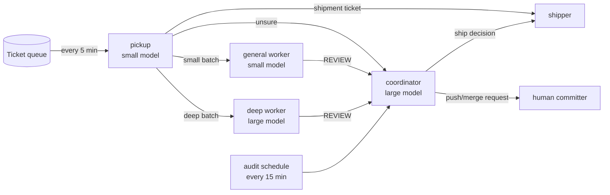

# Module 7 — Orchestrating many agents: roles, routing, state, one committer

## Why it matters

This estate's ticket triage started as **one agent on a 15-minute timer** that picked up a
ticket, fixed it, reviewed it and shipped it. Over about ten weeks it went through more than
eighty prompt versions. **Each version exists because the previous one failed in a specific,
measured way.** That history is the best orchestration curriculum available.

| version    | change                                                                                         | the failure it answered                                                                                                                                                         |
| ---------- | ---------------------------------------------------------------------------------------------- | ------------------------------------------------------------------------------------------------------------------------------------------------------------------------------- |
| v1–v2      | orchestrator + planner/executor/reviewer subagents on a 15-min cron; 24-hour window            | first autonomous loop                                                                                                                                                           |
| v2 addenda | auto-default after ~60 min with no reply; back-merge after every ship                          | loop idling on unanswered questions; branches drifting                                                                                                                          |
| v3         | two-week window; never self-terminate on an empty queue; re-arm before the cron's 7-day expiry | 24 h too short; scheduler expiry                                                                                                                                                |
| v4         | mandatory checkpoint comment on every phase change; stale-claim sweep                          | tickets sat claimed for a day with no comment, because **every run is a fresh agent and the ticket comment was the only state**                                                 |
| v5         | no doc change, **re-arm required**                                                             | the doc said two authorisers, but the _armed prompt_ still said one. **The text that fires is what runs.**                                                                      |
| v68→v82    | prompt split into three files on disk: safety net, procedure, append-only state                | prompt size; state had to outlive runs                                                                                                                                          |
| v82        | —                                                                                              | **carried no time window at all**, so it ran 12 days past its authorisation until a human stopped it. _A window that lives only in a document is documentation, not behaviour._ |
| v83        | window gate restored in the firing text                                                        | v82's missing window                                                                                                                                                            |
| v84        | **multi-agent pool** (below) on a persistent scheduler                                         | one agent doing everything exhausted its context; session-only cron died on restart                                                                                             |

## The principle

> **Separate roles, route by complexity, keep state in files, and have exactly one
> committer.**

## The v84 shape



| role               | model        | job                                                                                                               |
| ------------------ | ------------ | ----------------------------------------------------------------------------------------------------------------- |
| **pickup**         | small, cheap | query the queue, group related tickets, score complexity, route. Never does fix work itself                       |
| **general worker** | small        | small/medium fixes: one component, clear repro, ≤3 files, no migration                                            |
| **deep worker**    | large        | unknown root cause, cross-service, migrations, auth/session, failures reported by QA, families of related tickets |
| **coordinator**    | large        | review, ship/no-ship, escalations, 15-minute audit; the only one that can create or stop agents                   |
| **shipper**        | —            | deployments, infrastructure; submits a plan **before** every write                                                |
| **human**          | —            | the **only** committer: pushes, merges, names any production exception                                            |

### The routing rubric is written down

- **SMALL** → general: one component, clear repro, ≤3 files likely, no migration, no
  environment change, not cross-service.
- **DEEP** → deep worker: root cause unknown or contested, cross-service, migration,
  auth/session/org, any QA failure, any family batch.
- **ESCALATE** → coordinator: authority unclear, production in scope, needs a product
  decision, conflicting tickets, **or the router is not confident in its score.** It says why
  in one line.

**Group before routing.** Tickets from the same feature family go as one batch to one worker.
A product owner ruled that splitting one family across workers left the feature incomplete.

### Measured constraints that shaped it

These are not preferences:

- **Peers cannot create peers.** Workers are therefore a standing pool woken by mail, not one
  agent spawned per ticket. Orchestration is one level deep.
- **At most four agents run at once.** Pickup and shipper hold two slots, so at most **two
  batches are in flight**. The audit stops idle workers.
- **Session-only schedulers die on restart.** Standing schedules live in a persistent
  scheduler that survives restarts and deploys.
- **Mail is small.** The body is at most 256 characters, so detail goes in a state file and
  the mail points to it.

## State: one file per agent, append-only

```
loop/v84/<agent>.state.md   owned by that agent only; a dated section per turn
```

- **No shared writes.** Nobody writes another agent's state file. The coordinator reads them
  all.
- **The charter is re-read every turn.** A first-turn prompt gets compacted away, and a file
  on disk does not.
- **Snapshot before you append, and compare the prefix after.** A one-line Python slip,
  `open(p,'w').write(open(p).read()+new)`, truncated a 26,711-line state file to empty and
  reported success. A byte comparison caught it, not attention.

## Isolation: one worktree per batch

- Every batch gets its own `git worktree` on its own branch, cut from a freshly fetched base.
- **Never work in the shared checkout**, and **never `cd` into another agent's worktree**. Use
  `git -C <path>` and absolute paths. Changing directory can silently change which context
  file the harness loads.
- If two batches touch the same file, the first agent to notice mails the coordinator
  `CONFLICT`, and the coordinator decides who owns it.

## Communication protocol

| need                                      | to          | subject           |
| ----------------------------------------- | ----------- | ----------------- |
| finished work reviewed                    | coordinator | `REVIEW <keys>`   |
| unblock (credential, decision, authority) | coordinator | `BLOCKED <keys>`  |
| routing call the router cannot make       | coordinator | `ESCALATE <keys>` |
| slot free                                 | pickup      | `DONE <batch>`    |
| deploy plan, **before** writing           | coordinator | `PRE-SHIP <key>`  |

Humans are reached through comments on the ticket, never by guessing a channel.

## Lessons for liveness and authority

- **"Idle" is a weak reading.** A thread-status listing that says "working" is conclusive.
  One that says "nothing in flight" is not, because a busy agent between two tool calls looks
  idle. Confirm with a second reading a few minutes later, or with an artefact that moves
  (a new commit or comment) before stopping a peer. One worker was stopped mid-turn on the
  strength of its own "idle" message, which it had sent _during_ that turn.
- **Enforce through the owner, never over them.** One agent read the ticket-lifecycle rule
  correctly and told another to un-claim a ticket. The second had been told "claim it" by a
  human one turn earlier. The board does not record who instructed whom. Mail the holder and
  let them answer.
- **Two agents running the same check are one check.** If they share an instrument (the same
  checkout, the same query), their agreement is free. Make them differ in the instrument, not
  just in which agent runs it.

## When to use what

| need                                                           | use                                 |
| -------------------------------------------------------------- | ----------------------------------- |
| one bounded answer back in this conversation                   | a subagent                          |
| long-running work a human should be able to watch and redirect | a peer thread                       |
| a standing role woken by events                                | a pool thread + persistent schedule |
| a read-only sweep you will act on immediately                  | a subagent (e.g. `Explore`)         |

## Exercises

1. **Write your routing rubric.** Take 20 recent tickets, score each SMALL, DEEP or ESCALATE
   using the criteria above, and record where you hesitated. Those hesitations are what to add
   to the rubric.
2. **Design the state file.** What must an agent write at the end of a turn so that a
   _stranger_ can resume? Test it: give only the state file to a fresh agent and ask it to
   continue.
3. **Version history drill.** For your own automation, write the "failure it answered" column.
   If you cannot name the failure behind a rule, the rule is a candidate for deletion.
