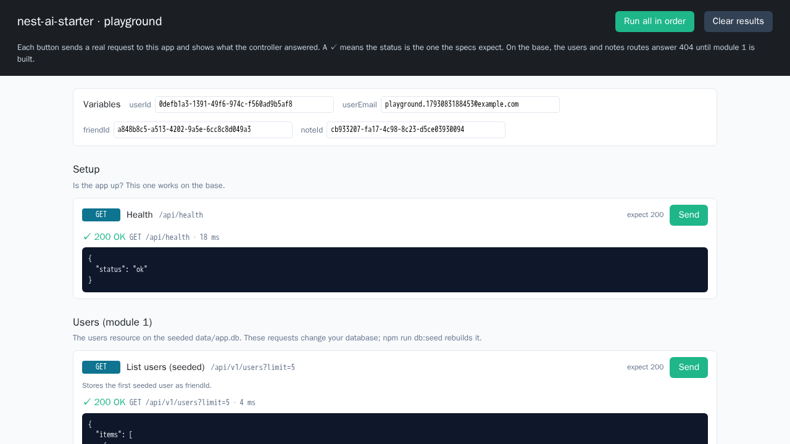

# Building Apps with AI Agents

**Lab companion · two modules · NestJS 12 · drizzle · SQLite · MCP**

<!--
Keep this deck on screen during lab work. Each module has: a divider (goal + time), PROMPT slides (what the proctor says and the exact prompt learners paste into their agent), CHECK IT (what learners run to check the agent's work), CHECKPOINT (what correct looks like) and WHEN THE AGENT GOES WRONG (mistakes agents actually made). The full explanations are in the chapter documents.
-->

---

## How every lab works

1. **Proctor**: the goal, where the requirements are, when it is done
2. **Instruct**: you give that to your agent, never the steps
3. **Agent**: works out how from the repo, then builds it
4. **Check**: npm run verify + npm run lab NN: read the counts
5. **Review**: ask it to show, not tell: the red run, the SQL

_Repeatable work → tools. Judgement → the agent, fenced in._

<!--
The AI does the building and the planning; the learner directs and checks. The instruction says what and when it is done, never how: the repo (CLAUDE.md, its skills, the specs) tells the agent how, and watching it find that out is part of the lab. Measured: fresh agents given only these instructions got every module's lab green. Hold the agent to evidence: counts, a failing run, the generated SQL.
-->

---

## NestJS: request flow

```text
[Request] → [Middleware] → [Controller] → [Service] → [Database]
```

**Request**: from the client · **Middleware**: runs first · **Controller**: the route · **Service**: the rules · **Database**: SQLite

<!--
Every request passes middleware first, then reaches a controller. The controller does no business logic: it calls a service. The service holds the rules and reads or writes the database (through a repository). The answer travels back the same way.
-->

---

## NestJS: who calls whom

```text
               ┌──────── Module ────────┐
[Middleware] ──▶ │   [Controller]         │
               │        ▼               │
               │    [Service]           │
               │        ▼               │
               │   [Repository] ────────┼──▶ [Database]
               └────────────────────────┘
```

<!--
A module groups one feature: its controller, its service and its repository. The controller calls the service; the service calls the repository; Nest connects them (dependency injection). Middleware sits outside the feature and runs before the controller. In module 1 your agent builds one module for users and one for notes.
-->

---

## Three rules for the lab

- **Windows, PowerShell, Node 24**: Every command runs in boilerplate\nest-ai-starter, one per line. npm ships with Node; scripts run as `npm run <name>`.
- **Counts, not exit codes**: Read "Tests N passed" AND "Test Files": a failed beforeAll shows 0 failures in the Tests line and exit 1.
- **The data is yours to break**: data/app.db ships seeded. Change it freely while you try things; `npm run db:seed` puts it back, byte for byte.

<!--
The audience is on Windows. Windows PowerShell 5.1 has no && (PowerShell 7 does), so every command is on its own line. Nobody needs curl: the playground page sends the requests. The base starts its tools with node and their JS entry, because the node_modules\.bin shims are .cmd files on Windows; measured on Linux, not yet on a Windows machine.
-->

---

## Try it in the browser: /playground

- **One page, every request**: With the app running, open http://localhost:3000/playground. It lists every module 1 request: health, users, notes and sharing.
- **Click to send**: Each Send calls the real controller and shows the status, a ✓ when it is the one the specs expect, and the body. Run all in order chains the ids.
- **It writes to your data**: Requests create, change and delete rows in data/app.db. `npm run db:seed` restores the seeded data.

<!--
Before module 1 is built, health is the only green row: the rest answer 404 or wait for an id. Module 2 has no playground: its client is Claude Desktop, over stdio. The Postman collection stays in the starter (postman/) for anyone who prefers it; the labs do not use it.
-->

---

## Lab checks: is my lab done?

- **One check per lab**: `npm run lab 01` runs the check for lab 01, `npm run lab` all of them. Done means `Test Files 1 passed` and every test green.
- **Red until built**: Every lab check fails on the starter, because its feature is not there yet. It turns green when your agent has built it, and stays green after.
- **Fell behind?**: Start the next module from its checkpoint (docs/ai-agent-training/checkpoints/), not by patching your own copy.

<!--
The checks drive the app over HTTP (lab 01, empty in-memory database) and the MCP server over stdio (lab 02, a copy of the seeded file), and never import learner code. The contracts are the specs; test/labs/README.md summarises them. Each module's reference result is a patch in docs/ai-agent-training/checkpoints/.
-->

---

## The track (draft lab times)

| mod | module                     | lab |
| --- | -------------------------- | --- |
| 1   | Users and notes            | 15' |
| 2   | An MCP server on your data | 15' |

<!--
Two modules, about 15 minutes each for Claude Code to build, so about 30 minutes of labs. Times are ESTIMATES: nobody has run these labs with an audience yet. Adjust after the first session.
-->

---

<!-- _class: lead -->

**MODULE 1**

# Users and notes

Your agent sets the project up, then builds the users and notes resources (notes shareable between users) on the seeded tables.

⏱ 15 min lab (draft estimate)

<!--
Covers chapters 00 + 01 + 02. Left out for time: nothing: the two stretch exercises of chapter 01 are for fast groups.
-->

---

## Instruction 1/3: set the project up

> **Proctor:** The data is already there. Have your agent set the project up, prove it works, and show you what is in the database.

**Give it to your agent** (paste, or say it in your own words):

```text
Set this project up on this machine and prove it works:
counts, not "it works". Then show me what is in the
database.
```

**Watch its approach**

- reads CLAUDE.md before running anything
- counts: 20 unit, 5 e2e, a red lab 01
- data: 25 users, 200 notes, 120 shares
- passes script flags after --

<!--
Measured: a fresh agent given only this instruction installed, built, started the app, and reported 20 unit / 2 e2e (5 e2e now, with the playground's test), lab 01 red, and the table counts (115 open and 85 done notes, 120 shares, none with its owner). If port 3000 is busy, PORT in .env (chapter 00).
-->

---

## Instruction 2/3: the users resource

> **Proctor:** Do not tell your agent how. The repo says how resources are built; watch whether it finds that out.

**Give it to your agent** (paste, or say it in your own words):

```text
Build the users resource on the provided users table:
specs/users.md. Done when npm run verify is green.
```

**Watch its approach**

- finds the steps: generate, template, fill
- keeps the provided table, 14 markers
- no migration for a provided table
- 409s left to the database, not re-coded

<!--
Measured: a fresh agent found the resource-spec and nest-resource-scaffold skills from CLAUDE.md on its own; the template kept users.table.ts and left 14 markers; verify went to 29 unit / 18 e2e. Lab 01 stays red until notes exist. Ask: which instruction told it to use the skill? None did.
-->

---

## Instruction 3/3: notes, with sharing

> **Proctor:** A user owns many notes; a note can be shared with many users. The rules decide where each piece goes.

**Give it to your agent** (paste, or say it in your own words):

```text
Now the notes resource, with sharing: specs/notes.md. Done
when npm run lab 01 and npm run verify are green.
```

**Watch its approach**

- stored-state rules in the service (422)
- filters and /shares routes, with e2e tests
- a bad dueAt is 400, not 500
- every rule broken once to see red

<!--
Measured: a fresh agent got lab 01 15/15 and verify 43 unit / 46 e2e. Its first dueAt answered 500 for "next tuesday" (zod 4 runs a transform after a failed format check); it found and fixed it. The filters and share routes go outside the markers, on purpose.
-->

---

## Check it: module 1

```bash
# 1. the tests first
npm run verify       # read both Tests lines
npm run lab 01       # the lab check: all green?
# 2. then the app on the seeded data
#    (.env from setup; port busy? PORT=)
npm run build
npm start
# 3. open localhost:3000/playground
#    and click Run all in order
```

**In the playground** (`localhost:3000/playground`)

1. Health
2. List users (seeded)
3. Create user
4. Create note
5. Mark done
6. Edit a done note → 422 (R2)
7. Share with a friend

<!--
Tests first: verify and the lab check run on an empty in-memory database, so a green result there is the proof the code works. Only then start the app and open the playground: it sends every module 1 request to the running app with one click and shows each answer, proving the resources also serve the seeded rows. Nobody needs curl. The playground writes to data/app.db; npm run db:seed puts the data back.
-->

---

## What to expect: the playground after Run all



- Every card has a ✓: 19 of 19 in our dry run
- Variables filled: each id is carried to the next request
- The 409 and 422 cards get a ✓ too: the rule refused, as the spec says
- List users shows the seeded rows from data/app.db

<!--
Captured in a dry run of the previous slide, in Chromium at 1280x720: base plus the module 1 checkpoint, verify 43 unit / 49 e2e, lab 01 15/15, then Run all in order: 19 of 19 cards green in about 3 seconds, no page errors. With DevTools open the 409 and 422 requests show in red as failed loads; that is expected, they are the rule checks. If List users comes back empty, the app is on the in-memory database: .env is missing (copy .env.example, chapter 00). npm run db:seed puts the data back afterwards.
-->

---

## Checkpoint: two MVCs on real data

_Output: captured_

```bash
# npm run verify (base: 20 unit, 5 e2e)
Tests  43 passed (43)
Tests  49 passed (49)
# npm run lab 01
Tests  15 passed (15)
# /playground on the seeded file
users total=25  notes total=200
notes?status=done total=85
```

**Done when**

- [ ] `npm run lab 01`: every test passes
- [ ] deleting a rule turns a test red
- [ ] the app lists the seeded rows

---

## When the agent goes wrong: module 1

- **It runs db:generate for users**: The table is provided: there is nothing to generate. npm run verify (check:migrations) proves it.
- **A bad dueAt answers 500**: Zod 4 runs the transform after a failed datetime check. Guard it; the scaffold skill lists the trap.
- **It counts notes before deleting a user**: A second copy of a rule the foreign key already enforces. Let the database refuse; map the error.

---

<!-- _class: lead -->

**MODULE 2**

# An MCP server on your data

Your agent builds an MCP server that queries and changes the database; you connect it to Claude Desktop and have Claude read and write your data.

⏱ 15 min lab (draft estimate)

<!--
Covers chapters 03 + 04. Left out for time: the stdio framing lab (chapter 03): reading one exchange covers it.
-->

---

## MCP next to REST: a second front door

```text
REST · module 1                     MCP · module 2
[Browser · /playground]            [Claude Desktop]
   │ HTTP: GET /api/v1/notes           │ JSON-RPC over stdio: tools/call
   ▼                                  ▼
[Controller (routes)]              [MCP server (tools)] ┄┄┐ query · execute:
          ╲                          ╱                  ┆ raw SQL, guarded
           ▶ [Services: the rules] ◀                    ┆
                    ▼                                   ┆
         [Repository → data/app.db] ◀┄┄┄┄┄┄┄┄┄┄┄┄┄┄┄┄┄┄┄┄┘
```

Same services, same rules: MCP replaces the controller, not the app. MCP messages are JSON-RPC; the transport is stdio here (Claude Desktop starts the server) or Streamable HTTP for a remote server.

<!--
Module 1 built the REST front door: an HTTP request reaches a controller, the controller calls a service, the service holds the rules. Module 2 adds a second front door for an AI client. The MCP server takes the controller's place: each tool parses its input and calls the SAME UsersService and NotesService, so the rules exist once. Measured: removing the never-shared-with-the-owner rule from NotesService turns both the REST tests and the MCP checks red. Two tools are the exception: query and execute run SQL a model wrote, straight on the database, so the server guards them itself. On the wire, MCP is JSON-RPC messages, not REST routes. They travel over a transport: stdio when Claude Desktop starts the server on your machine (what we build), or Streamable HTTP for a server you reach over the network. So MCP can ride on HTTP, but it is not built on REST.
-->

---

## Instruction: an MCP server on your data

> **Proctor:** The goal: your Claude Desktop app queries and changes this database. The model writes the SQL, so the server decides what may run.

**Give it to your agent** (paste, or say it in your own words):

```text
I want to use this data from Claude Desktop. Build the MCP
server in specs/mcp.md. Done when npm run lab 02 and npm
run verify are green; then show me how to connect it to
Claude Desktop, one question I could ask it and one change
I could ask it to make.
```

**Watch its approach**

- reads the installed SDK, not its memory
- typed write tools call the module 1 services
- query and execute each guarded in layers
- gives the Claude Desktop entry with absolute paths

<!--
Measured: a fresh agent got labs 31/31 and verify 46 unit / 58 e2e. Five SQL guards, each removed once and caught by lab 02: query is one SELECT/WITH statement (libSQL silently drops a second) run under PRAGMA query_only (a WITH can hide a delete); execute is one statement, only INSERT/UPDATE/DELETE, and UPDATE/DELETE need a WHERE. Its own e2e test missed two of the five: the lab checks come from the spec, not the code. The typed write tools call UsersService and NotesService, so removing a rule there turns the MCP checks red too. execute keeps foreign keys on but does not apply the service rules; its description says so.
-->

---

## Check it: module 2

```bash
npm run verify
npm run lab 02       # the lab check: all green?
npm run build
node scripts\claude-desktop-config.mjs
# paste the entry into the config file it names,
# quit and reopen Claude Desktop, then ask:
# "Which open notes are shared with more
#   than one person?"
# "Add a user Ada, ada@example.com, with
#   a note due next Friday"
```

<!--
Claude Desktop starts the server from its own folder with a minimal PATH, so the entry needs absolute paths for node, the server and the database: the script prints them. Quit Claude Desktop completely (not just the window) before reopening. The lab runs on a COPY of data/app.db; Claude Desktop writes to the real one, and npm run db:seed puts it back.
-->

---

## Checkpoint: Claude Desktop, your data

_Output: captured_

```bash
# npm run verify; npm run lab
Tests  46 passed (46) · 58 passed (58)
Tests  31 passed (31)
# started as Claude Desktop does it
create-user · create-note · share-note
execute update … where id = … → 1 row
# execute: delete from notes
NOT_ALLOWED: DELETE without a WHERE …
```

**Done when**

- [ ] `npm run lab 02`: every test passes
- [ ] query refuses a write, execute an unbounded one
- [ ] Claude Desktop answers a question and makes a change

---

## When the agent goes wrong: module 2

- **query checks the SQL string only**: A write can hide inside a WITH. Ask for PRAGMA query_only too, and a test that tries it.
- **execute runs any SQL it is given**: One statement, INSERT/UPDATE/DELETE only, a WHERE on UPDATE and DELETE. Ask for a test per refusal.
- **Claude sees no tables**: The server started in another folder and got an empty database. Use absolute paths; the server should exit when the file is missing.
- **Claude Desktop shows no notes-db tools**: A relative path or a bare node in the entry. Use the script's absolute paths, then quit Claude Desktop fully and reopen.

---

# What you built

Seeded SQLite → Users → Notes + sharing → MCP server → Claude Desktop

Next: authentication before anyone else can reach it · an HTTP transport for a shared server · your own tables and tools

<!--
Close by asking each learner for one thing their agent got wrong, and how they found out: a count, a red test, the SQL.
-->
